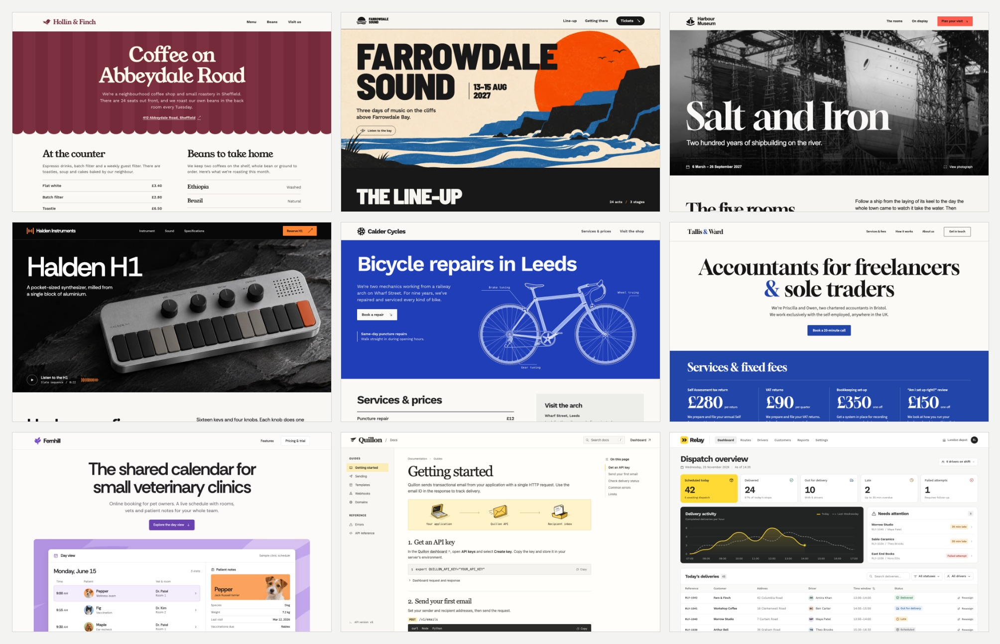
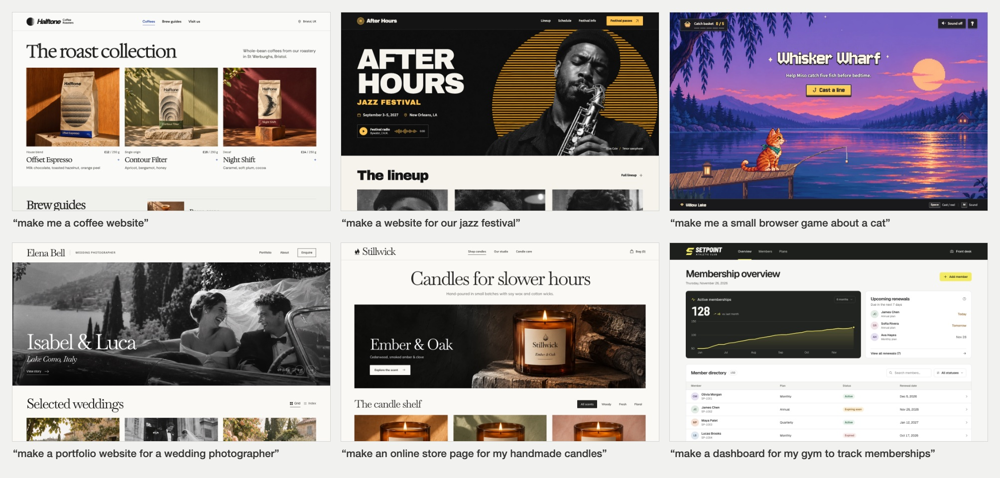

# Skills

Open-source skills by [novnski](https://github.com/novnski) for Codex, Claude Code, Cursor and other coding agents. Each package in [`skills/`](skills/) follows the [Agent Skills format](https://agentskills.io/) and contains a `SKILL.md` instruction file, plus any references or scripts the agent needs.

**[Browse the skills catalog](https://skills.novnski.chatgpt.site/)** to search by task, find a package’s install command and open its guide.

## Available skills

| Package | What it does | Explore |
| --- | --- | --- |
| [`better-design`](skills/better-design) | Guides interface design and review, with checks for both the source code and the rendered page. | [Skill guide](https://better-design-skill.novnski.chatgpt.site/) · [Example gallery](https://better-design-skill.novnski.chatgpt.site/examples/) |

## Install

From your project, list the available packages with the [`skills` CLI](https://github.com/vercel-labs/skills).

```bash
npx skills@latest add novnski/skills --list
```

To install a single skill, pass its package name with `--skill`. This example installs Better Design.

```bash
npx skills@latest add novnski/skills --skill better-design
```

The CLI asks which agents to install to. Add `-g` to install for every project, or `-a codex` to name the agent up front.

```bash
# Install every skill
npx skills@latest add novnski/skills

# Update installed skills later
npx skills@latest update
```

The CLI needs Node.js 22.20 or later.

## Better Design



Nine first screens built by a coding agent with this skill, each from a prompt of a few paragraphs. Every brand and all content are invented.



A short prompt is enough. Each of these six came from the one line under it. The skill has the agent decide what the line left open (a name, a place, real prices and hours) and list it as made up when it hands the page over.

Pages made by a coding agent tend to look alike: the same split first screen, the same three cards, the same accent, the same typeface. better-design gives the agent a way to decide what a page should be before it writes code, a floor of craft rules that hold for any interface, and scripts that measure the built page and fail what is generic.

**Use it when**

- building, restyling or reviewing a website, landing page, app screen, dashboard, form or component;
- something should look more professional, more original, or less AI-made;
- fixing hierarchy, spacing, typography, color, responsiveness or dark mode.

**How it works**

1. **It reads the request first.** What the request fixes is kept in its own words. A look it names, such as "a 1920s opera palace", is carried out at full strength. What a short request leaves open is decided and written down.
2. **A brief, saved to a file.** The agent writes down the subject, the audience, the default it would have built, three other directions, and the one it takes, with the headline and the single main action word for word. The direction is picked by a count of the words in the request, so the agent cannot take its favorite layout every time.
3. **A register.** Utility, expression, showpiece or piece. A settings page and a festival site get different amounts of expression and the same care. A piece is one thing the person acts on, such as a game, a kiosk or a configurator: it fills the screen, and the controls sit on it.
4. **A craft floor.** Tokens, hierarchy, type, color, space, states, content, motion and accessibility, with reference files for each.
5. **Count.** `scripts/check.mjs` reads the source and prints PASS or FAIL for about twenty limits, such as font sizes off the scale, reflex typefaces, tinted grays, and an accent that does not match the brief.
6. **Look.** `scripts/look.mjs` opens the page in a real browser at three widths and runs about forty checks on what only shows once it is rendered, such as contrast, overflow, focus, dead buttons, several buttons that lead to one place, a band of stats under the first screen, and numbers in little boxes.
7. **Controls that work for people and for agents.** A new web front-end takes the behavior of its controls from [UI SDK](https://github.com/vercel-labs/ui) and connects its agent bridge, so the page has proper keyboard and focus handling and an AI agent can read and use it.

The limits come from measurement. Each suspected habit was counted on generated pages and on dozens of well-known real sites, and a check fails only what real sites almost never do.

**What it needs**

- Node.js 18 or later for the scripts. They have no dependencies.
- Any Chromium-based browser for `look.mjs`: Chrome, Chromium, Edge, or one that Playwright or Puppeteer downloaded. Set `CHROME=/path/to/browser` to choose one.

**What is inside**

```
skills/better-design/
├── SKILL.md          the method, the craft floor and the review
├── references/       reading the request, briefs, color, typography, copy,
│                     interaction, tokens, page types, generic patterns,
│                     showpiece pages, pieces, UI SDK
└── scripts/
    ├── check.mjs     counts the limits in the source
    ├── look.mjs      checks the rendered page in a browser
    ├── habits.mjs    the in-page detectors look.mjs uses
    └── palette.mjs   measures how much of a screenshot is neutral, tinted and colored
```

**Limits worth knowing**

- It was developed and tested on OpenAI Codex, across about 120 real builds. It is written for any agent, and is less tested on others.
- The scripts count; they cannot tell whether a page was designed. The skill says so, and asks the agent to look at its own captures.
- Ask for the same subject twice and the two pages will be related. Different subjects come out different.
- Across many sites, a few typefaces still come back more often than they should.
- UI SDK is in beta. The skill bundles it into the page, and only your own words in the prompt turn it off.

## Repository layout

```
skills/
└── <skill-name>/
    ├── SKILL.md       required: frontmatter with name and description, then the instructions
    ├── references/    optional: documents the agent reads when it needs them
    └── scripts/       optional: tools the agent runs
```

Each folder under `skills/` is one skill, and the folder name is the skill's name. `node scripts/validate.mjs` checks every skill against the format; it runs on every push.

## License

[MIT](LICENSE)
